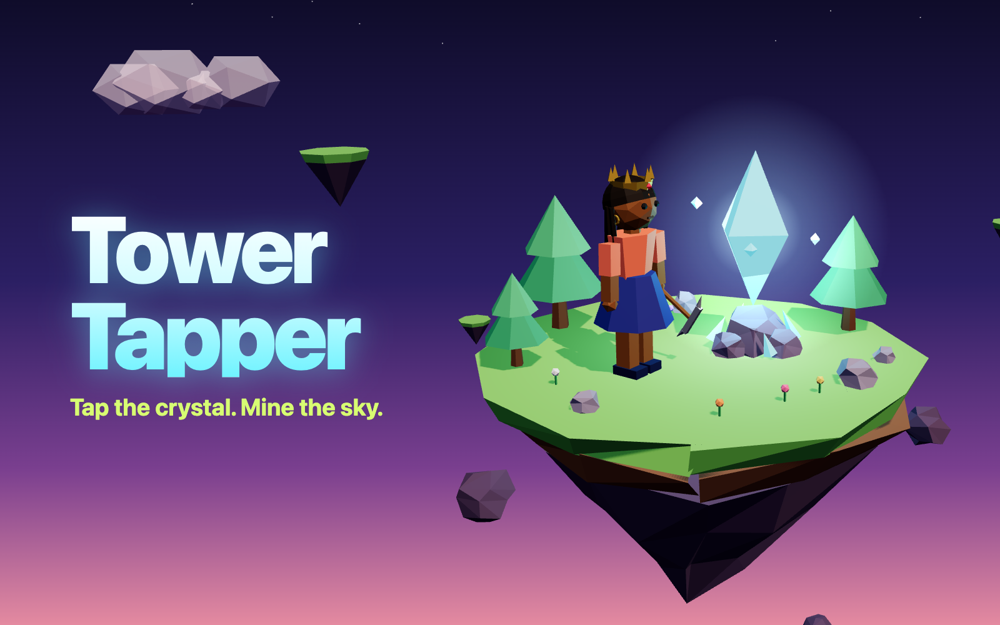

# Tower Tapper

An idle clicker for [start.ng](https://start.ng), built with three.js. Your start.ng character stands on a floating island and taps a glowing crystal to mine gems.

**Play:** https://tower-tapper.start.ng



## How to play

- **Tap the crystal** to mine gems.
- **Buy upgrades** to earn more per tap and to earn gems every second. Each one costs 15% more than the last (`base × 1.15^owned`).

  | Upgrade | Effect | Base price |
  | --- | --- | --- |
  | ⛏️ Sharper Pick | +1 gem per tap | 15 |
  | 🛸 Crystal Drone | +1 gem/sec | 50 |
  | 🧤 Lucky Gloves | +6 gems per tap | 400 |
  | 🗿 Gem Golem | +10 gems/sec | 1,200 |
  | 🔔 Resonance Chime | +60 gems/sec | 14,000 |
  | 🏭 Sky Refinery | +400 gems/sec | 160,000 |

- **Rebirth** once you've mined 1,000,000 gems in a run. Your gems and upgrades reset, and you get `floor(√(run gems / 1M))` **Star Shards**. Each shard adds +10% to all income, forever.
- **Time away counts.** Progress is saved in your browser, and your passive income keeps going while you're away, for up to 8 hours.

## Your start.ng character

The miner on the island is your start.ng character, built from your style in [`character.js`](./character.js) (`buildCharacter(style)`):

| Style field | In the game |
| --- | --- |
| `body` | `female`: skirt and a narrower waist. `male`: trousers and a boxier torso |
| `primaryColor` | Top and sleeves |
| `secondaryColor` | Trousers or skirt (plus cap and beanie) |
| `skinColor` | Head, neck and hands |
| `hairColor` | Hair, beard and moustache |
| `hair` | `short`, `afro`, `braids`, `bun`, `ponytail`, `dreads` and `bald` each have their own mesh |
| `hat` | `cap`, `beanie`, `tophat`, `crown`, or `none` |
| `accessory` | `glasses`, `earrings`, `beard`, `scarf`, `backpack`, or `none` |

Missing or unknown values fall back to defaults. If you change your look, or sign in or out on start.ng, the game picks up the change when you come back to the tab. It rebuilds the character without touching your progress.

Guests play with start.ng's guest look and get a **Sign in** button.

## Leaderboard

[`startng.json`](./startng.json) sets up two columns: **Rebirths** and **Best gems/sec**. A run is saved when you rebirth, or when you press **Submit score**. Both stats are rounded and clamped to whole numbers from 0 to 1,000,000,000. The **Top 10** panel highlights your own row.

## Files

| File | What it does |
| --- | --- |
| `index.html` | Page and HUD markup. three.js comes from a pinned jsDelivr import map (`three@0.170.0`) |
| `style.css` | HUD and shop overlay. Portrait-first, with the shop on the right on wide screens |
| `main.js` | three.js scene, taps, animations, UI and start.ng wiring |
| `character.js` | `buildCharacter(style)` and `disposeCharacter(group)` |
| `game.js` | State, economy, prestige, saving and offline earnings |
| `startng.js` | start.ng connect-page helper (`askStartNg`, with the origin check) |
| `startng.json` | Leaderboard columns |
| `cover.png` | 1600×1000 card picture, rendered from the game (`index.html?cover`) |

## Run it locally

There's no build step. Browsers won't load ES modules from `file://`, so serve the folder:

```sh
python3 -m http.server 8000
# open http://localhost:8000
```

Off `*.start.ng`, start.ng doesn't answer, so the game plays with a default character. Sign-in and the leaderboard work once it's live on start.ng.
